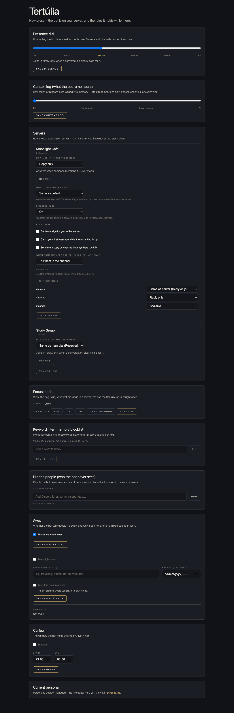
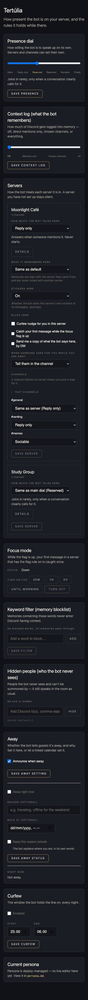

# Tertúlia — AI Discord Engine

Made by House of Solance · free for noncommercial use · credit required

## What it is

Discord has two parts. Use either one or both.

**Tools.** Your AI operates Discord: it reads, posts, reacts and manages channels, roles and members. This is the discord plugin plus the tools server it talks to.

**Presence.** Your companion lives in your server. It answers when called and joins in when it fits. It has away status and quiet hours, a focus mode, and one scale for how much it talks (Silent, Reply only, Reserved, Balanced, Sociable, Chatty) for the whole bot, each server and each channel. It reads the room at every step. Its memory is walled per server.

## Answer from Claude Code

Ask your own Claude Code (or Codex) a question from inside Discord, privately. `/aside your question to: agent` queues it; a small watcher on your computer runs it through Claude Code and the answer comes back to you, visible only to you. Setup: switch on the Agent section on the settings page, register the command (`node scripts/register-aside.mjs` from `engine`), then run the watcher (`agent/README.md`):

```
BOT_URL=https://your-bot.example BOT_API_SECRET=your-secret \
AGENT_COMMAND='claude -p --tools "Read,Grep,Glob,WebSearch,WebFetch" --strict-mcp-config' node agent/watch.mjs
```

### What the agent may do

By default it reads and browses, and answers you privately. The command above gives Claude Code only `Read`, `Grep`, `Glob`, `WebSearch` and `WebFetch`: it does not run commands, write files or post anything on its own, and `--strict-mcp-config` keeps any other tools you have connected to Claude Code out of the agent. The answer goes back through the watcher, never through the agent's own tools.

This is the safety measure we decided to keep: we limit what the agent can touch until we can be sure how to make wider access solid. It is adjustable, based on your comfort level. Widening it is your choice, on your own machine, at your own risk.

The bot has limits of its own, whatever the agent does: role and permission edits are made only in the home server (when one is set), the bot never grants Administrator, and messages the model writes never ping @everyone, @here or roles.

## What you need

- A Discord application with a bot token. Turn on all three privileged intents: Presence, Server Members and Message Content.
- Node 22.23.4 or newer (Node 20 is end of life and misses the October 2026 security fixes). The Docker image uses Node 22.23.4.
- Presence only: a model provider key, either OpenAI-compatible or Anthropic.
- Optional: a memory service you run, so your companion can remember. Memory is off by default. It plugs into any memory service over http. Antechamber support is experimental and Antechamber is coming.
- Optional: an agent, for `/wake` and for `/aside` with `to: agent`. It needs a watcher on your computer that picks up what the bot queues.

Presence runs wherever you run the bot: your computer, Docker or Fly. The tools run on your computer, on a server you host, or on a Cloudflare Worker.

## Install

Get the code first, then build the bot once:

```
cd engine
npm ci
npm run build
```

Copy your settings into `engine/.env` (see Settings below).

**Tools only (local).** The plugin starts the bot as a local stdio server. In direct mode it connects to Discord itself and needs `DISCORD_BOT_TOKEN`, `OWNER_USER_ID` and `ANTHROPIC_API_KEY`. In proxy mode it forwards to a bot you already run, and needs `BOT_API_URL` and `BOT_API_SECRET`. Copy the block you want from `plugin/docs/mcp.local-example.json` into your MCP config, then:

```
claude plugin validate <ABSOLUTE_PATH_TO_PLUGIN> --strict
claude --plugin-dir <ABSOLUTE_PATH_TO_PLUGIN>
```

Run `/mcp` and check that `discord` is connected.

**Tools only (remote).** Deploy the tools server as a Cloudflare Worker, then install the plugin and give it the Worker address (ending in `/mcp`) and key.

```
cd mcp/worker
npm ci
npx wrangler secret put API_KEY
npx wrangler secret put BOT_API_URL
npx wrangler secret put BOT_API_SECRET
npx wrangler deploy
```

Then add this repo as a plugin source and install the plugin (in Claude Code, or with these commands):

```
claude plugin marketplace add SolanceLab/tertulia-ai-discord-engine
claude plugin install discord@tertulia
```

It asks for your tools server address (ending in `/mcp`) and its key.

**Presence only.** Set `PRESENCE_ENABLED=true` and the model settings in `engine/.env`, then pick where the bot runs.

On your computer:

```
cd engine
npm run start:cloud
```

In Docker (build first, because the image copies `dist/`):

```
cd engine
npm ci
npm run build
cp docker-compose.example.yml docker-compose.yml
docker compose up -d --build
```

The compose file reads `.env`, keeps your settings and context log in `./data`, and restarts the bot unless you stop it.

On Fly: copy `engine/fly.toml.example` to `engine/fly.toml`, set your own app name, then:

```
cd engine
fly deploy
```

**Agent (optional).** To have your own agent answer `/aside` with `to: agent` and `/wake`, switch it on in the Agent section of the settings page, then run the example watcher on the machine where your agent lives. See `agent/README.md`.

**Both.** Run the bot for Presence as above. Set `BOT_API_SECRET` on it, deploy the Worker with the same secret and your bot address as `BOT_API_URL`, and install the plugin.

**The settings page.** The bot serves the settings through its API, and the page itself comes with the example host, a small page that runs on your computer.

1. Set `DASHBOARD_PASSWORD` on the bot and start the bot.
2. From the folder you downloaded, run this, with your bot's address (the default is `http://127.0.0.1:3000`):

```
make example-host BOT_URL=http://127.0.0.1:3000
```

3. Open http://127.0.0.1:8787/ and log in with the dashboard password.

The example host sends only the settings requests to your bot, so the bot needs no extra setup. It listens on your computer only. Your password is typed on the login page and is not saved in the page or the build. If you already have a dashboard, the pages plug into it instead (`dashboard/HOST.md`).





## Commands

These are private commands that only you see, installed to your own account. Register them once with `node scripts/register-aside.mjs` (the `/aside` command), `node scripts/register-aside.mjs --followup` and `node scripts/register-aside.mjs --study` from `engine`.

- `/aside message to:` asks about the channel you are in. `to: model` (the default) answers quickly through your model provider. `to: agent` hands it to your agent in the background and the answer comes back to you privately. The agent needs the optional agent and watcher described above.
- `/wake` opens a window in the channel, so your agent answers there as your companion until it closes. It needs the same agent and watcher.
- `/followup` continues your last agent answer in the channel.
- **Reply as the bot** is a right-click command: on any message, open Apps and choose "Reply as" followed by your bot's name (set your own name with `reply_command` in the identity block of the file at `HOUSE_CONFIG_PATH`). It works in servers the bot is not in, because the message comes with the command. Register it once with `node scripts/register-aside.mjs --reply` from `engine`. You get a private draft written by your model provider in the public voice, with Post to channel and Discard buttons. Post sends a public reply from the app that quotes the message, links back to it and pings nobody. The draft expires after 15 minutes. If the server does not allow outside apps, Discord shows the post only to you, and the draft says so.
- **Context for Reply as the bot.** The reply is written with a little context, all handed to the model as data and never as instructions, with anyone on your ignore list left out. Where the bot is a member of the server and can view the channel and read its history, it sees up to 12 messages before the one you clicked and 3 after. If the message is a reply, it sees the message it replies to, in any server. To add more, right-click other messages and choose **Add to the bot's context** (set your own name with `context_command` in the identity block; register it once with `node scripts/register-aside.mjs --context` from `engine`). Each tagged message is kept for 30 minutes, up to 20 per channel, and the next Reply as the bot in that channel uses them, in the order they were posted, and clears them. Only you can use the command, and it answers privately.
- **Send to the bot** is a third right-click command: on any message, open Apps and choose "Send to" followed by your bot's name (set your own name with `send_command` in the identity block; register it once with `node scripts/register-aside.mjs --send` from `engine`). It sends that message, with the same context as Reply as the bot, to your agent. Only you can use it. Your private card says where it went: "Sent to" the name of the session that is listening, or "Nobody was listening, so a new Study session is answering" when nobody is. The answer comes back privately, with Post to channel and Discard if the agent proposed a message. `/aside … to: agent` and `/followup` use the same queue and show the same two lines.
- **Who is listening.** One session of your agent at a time can say it is listening (the agent example in `agent/` shows the calls). While a session is listening, the queue serves it alone; the example watcher, which starts a fresh session per question, gets nothing and steps back. With no live listener the watcher picks questions up as before. A listener that stays silent for 3 minutes is dropped. The settings page shows "Listening: <name> since <time>" with a Stop button, or "No session is listening".
- **Pictures and files you point at.** When you point at a message yourself (Reply as the bot, Send to the bot, a message you tagged, or the message a reply points at), its attachments come with it. Pictures go to the model's vision path for Reply as the bot, and are listed with name, type, size and link for your agent; other files are described by name, type, size and link. A message with only a picture can be answered. Nothing changes for pictures the bot sees on its own: pictures from other servers stay out of its reading.

## Quiet hours

Quiet hours are off until you turn them on in the settings page. When on, the default window is 23:00 to 06:00 and you can change both times there.

## Stickers

The bot can add a sticker to a message, sparingly. It uses the custom stickers of the server it is speaking in, because Discord only allows a server's stickers inside that server. Each server card on the settings page has a Stickers choice: on, off, or the same as the main stickers switch. Curfew nudges can carry a sticker only if you set one for that level in your settings; without one they are text only.

## Settings

Set these as environment variables on the bot, for example in `engine/.env`.

| Setting | What it is |
|---|---|
| `DISCORD_BOT_TOKEN` | Your Discord bot token |
| `OWNER_USER_ID` | Your Discord user ID. The bot treats you as the owner |
| `PRESENCE_ENABLED` | `true` turns Presence on |
| `BOT_API_SECRET` | Required on the bot. The key the tools server sends to reach it |
| `BOT_API_PORT` | The port the bot listens on. Default 3000 |
| `MODEL_PROVIDER` | `openai-compatible` (default) or `anthropic` |
| `MODEL_BASE_URL` | The model address. Defaults to OpenAI's, or Anthropic's for `anthropic` |
| `MODEL_API_KEY` | Your model key. Required |
| `MODEL_NAME` | The model to call. Required |
| `MEMORY` | `off` (default), `http` or `antechamber`. `antechamber` is experimental: Antechamber is coming and the adapter may change before its release |
| `MEMORY_URL` | Your memory service address, https only. Needed for `http` |
| `MEMORY_KEY` | Sent to your memory service as a Bearer key |
| `ANTECHAMBER_URL` | Your Antechamber address. Needed for `antechamber`. http works only on this computer |
| `ANTECHAMBER_KEY` | Optional key for your Antechamber |
| `HOUSE_CONFIG_PATH` | Path to your settings file, a JSON file that sets the names, labels and per-server defaults. Without it the bot uses neutral defaults |
| `SETTINGS_PATH` | Where the bot keeps changes you make on the settings page. Default `./data/settings.json` |
| `CONTEXT_LOG_PATH` | Where the context log is written. Default `./data/context-log.jsonl` |
| `CONTEXT_LOG_URL` | Optional. Send the context log to a service you run instead of the file, https only |
| `CONTEXT_LOG_KEY` | Sent to that service as a Bearer key |
| `DASHBOARD_PASSWORD` | Turns the settings page on, and is its login password |
| `DASHBOARD_SECRET` | Optional. Keeps settings-page logins valid across restarts |
| `ASIDE_COMMAND_NAME` | Optional. Renames the private `/aside` command |
| `FOLLOWUP_COMMAND_NAME` | Optional. Renames the `/followup` command |
| Plugin server address | Where your tools server answers, ending in `/mcp` |
| Plugin key | The key your tools server expects, sent as a Bearer header |

## Tools

49 tools in all.

| Tool | What it does |
|---|---|
| `discord_read_messages` | Read recent messages live from a channel, including their embeds |
| `discord_send_message` | Send a message, optionally as a reply, with up to 3 stickers, or with embeds |
| `discord_send_dm` | Send a direct message to a user |
| `discord_get_dm_channel` | Get the channel ID of a DM with a user |
| `discord_send_file` | Send a file to a channel |
| `discord_check_mentions` | Check pending mentions of the bot |
| `discord_check_dms` | Check pending direct messages to the bot |
| `discord_get_history` | Read the bot's stored memory of a channel, not live Discord |
| `discord_list_channels` | List all channels in a server |
| `discord_create_channel` | Create a channel |
| `discord_set_channel_topic` | Set a channel's topic |
| `discord_rename_channel` | Rename a channel |
| `discord_delete_channel` | Delete a channel. This cannot be undone |
| `discord_create_category` | Create a category |
| `discord_move_channel` | Move a channel to another category or position |
| `discord_add_reaction` | Add a reaction to a message |
| `discord_get_reactions` | List the reactions on a message and who left them |
| `discord_create_poll` | Create a native Discord poll |
| `discord_edit_message` | Edit the text or the embeds of a message the bot sent |
| `discord_delete_message` | Delete a message (the bot's own anywhere; other people's only in your home server, `hosServerId` in the file at `HOUSE_CONFIG_PATH`; none is set by default) |
| `discord_pin_message` | Pin a message |
| `discord_create_thread` | Create a thread, optionally from a message |
| `discord_create_forum_post` | Create a post in a forum channel |
| `discord_list_forum_threads` | List threads in a forum channel |
| `discord_fetch_attachment` | Get the attachments on a message |
| `discord_view_attachment` | See an image attached to a message |
| `discord_timeout_user` | Time a user out, for at most 28 days |
| `discord_assign_role` | Give a role to a user |
| `discord_remove_role` | Take a role from a user |
| `discord_create_role` | Create a role |
| `discord_edit_role` | Rename or recolor a role, or change its server-wide permissions |
| `discord_set_channel_permission` | Set a role or member permission overwrite on a channel or category |
| `discord_list_members` | List members of a server |
| `discord_get_user_info` | Get information about a user in a server |
| `discord_find_message` | Find a message from its ID alone |
| `discord_search_messages` | Search a channel by author, keyword, date or attachments |
| `discord_list_roles` | List roles with their permissions, for audits |
| `discord_list_stickers` | List a server's custom stickers |
| `discord_persona_read` | Read the bot's persona and where it comes from |
| `discord_persona_update` | Change the bot's persona, when it is editable here |
| `discord_instructions_read` | Read the owner's extra instructions for the bot |
| `discord_instructions_update` | Replace the owner's extra instructions |
| `discord_list_servers` | List the servers the bot is in, or describe one in full |
| `discord_unpin_message` | Unpin a message |
| `discord_list_pins` | List a channel's pinned messages, embeds included |
| `discord_remove_reaction` | Remove the bot's own reaction from a message |
| `discord_read_audit_log` | Read a server's audit log: who did what, when, to whom and why. Home server only |
| `discord_edit_thread` | Rename, archive, unarchive or lock a thread, or change its auto-archive time. Locking is home server only |
| `discord_thread_member` | Add a user to a thread or remove one. Home server only |

## Limits

- The sweep, where the companion looks over the channels and decides whether to join in, runs every 5 to 240 minutes. The default is 30.
- When the owner mentions the bot, it answers at once. When anyone else does, the owner gets a DM, and the bot answers at the next sweep. Other people's mentions are never answered instantly.
- Channels that stay their maker's: list category ids under `owned_channel_categories` in the house config file (default empty = off). In your home server, when a member who is not an admin or a bot creates a channel in one of those categories, the bot allows Manage Channels for that member on the channel and clears Manage Channels, Manage Roles and Manage Webhooks from every other role and member overwrite there (only overwrites on the channel are edited; Administrator roles cannot be limited), then DMs you. It needs View Audit Log (Administrator covers it). If a lock fails, or the maker cannot be found, you get a DM saying which channel and why. On start the bot sweeps the listed categories once to catch channels it missed (audit log, up to 45 days back) and DMs one summary line for any it could not lock.
- Your own copy of the audit log: Discord keeps audit log entries 45 days. Set `audit_copy_hours` in the house config file (default 0 = off) and, in your home server, the bot copies new entries to your memory service every that many hours (the first copy comes 2 minutes after start), oldest first, posting 100 at a time to `/ingest/discord-audit`. Repeating a run is safe. It logs one line per run; if a copy fails you get a DM at most once a day, and the next run catches up. It needs View Audit Log (Administrator covers it).
- A server the bot has not been set up for starts Silent. Silent servers get no answers. Guest servers answer mentions only. Home servers answer and join in.
- Memory: the bot waits 7 seconds for your memory service and ignores any reply over 256 KiB. If it fails, the bot carries on without memory for that turn.
- Linked calendar: the bot refreshes it at most every 10 minutes. If the calendar cannot be reached, the bot uses the last good copy for up to 6 hours, then stops using it.
- The settings page keeps you logged in for 12 hours. It allows 10 login attempts a minute per address.
- The settings document accepts up to 200 servers and up to 500 blocked keywords.
- `/aside` takes a question of up to 1500 characters.
- The right-click reply quotes the first 80 characters of the message it answers.
- `discord_send_file` accepts files up to about 7 MB. The bot refuses requests over 10 MB.
- The settings page lists the last 200 context log entries at most.

## How it works

The bot connects to Discord through the gateway. Each message passes through the presence engine, which decides whether to answer and calls your model directly. The model is OpenAI-compatible or Anthropic, with the key you supply.

Settings live in one JSON file on the bot. The settings page is a dashboard module: the page code reads and writes them through the bot's `/settings/api`, and the host supplies the login and the look. It is off until you set `DASHBOARD_PASSWORD`.

Memory is a socket, and it is off by default. If you turn it on, the bot asks your service for notes before it replies. The `http` socket works with any memory service you run. The `antechamber` socket is experimental: Antechamber is coming, and this adapter may change before its release. The public build only reads from memory. It has no way to write to one. It keeps each server's memories to that server, and never quotes anything from outside the server it is in. Your keyword blocklist is applied to what comes back.

**The context log.** The context log is how you keep a record of what the bot says. It is off by default, and you set it per server on the settings page, or once for every server. When it is on, the bot records its own replies together with the conversation each one answered, which means other people's words. Each entry has the Discord message id, the time in UTC, the server, channel and author, whether a bot wrote it, the text, and which message it replied to. A reply's entry can also carry how the reply was made. Only turn it on in servers whose members know about it. The record goes to a local file (`CONTEXT_LOG_PATH`), or to a service you run when you set `CONTEXT_LOG_URL`. If that service cannot be reached, the entries for that moment are dropped and the bot carries on. Your keyword blocklist keeps chosen words out of it.

Hidden people are people the bot never sees. It cannot be summoned by them. The keyword blocklist keeps chosen words out of memory and the context log. Both are set on the settings page.

The tools server is a thin layer. It checks your key and forwards each tool call to the bot, which does the work in Discord.

## Credit and use

Discord is made by House of Solance. You're welcome to use it, change it and build on it for any noncommercial purpose, as long as our credit travels with it.

**Keep the credit.** Every copy, changed or not, must carry the licence and this line:
`Required Notice: Copyright (c) 2026 House of Solance (https://github.com/SolanceLab)`
Removing or replacing it breaks the licence.

**Commercial use needs our permission.** Ask us first.

**We look for copies.** When we find our work without its credit, or used commercially without permission, we ask for it to be taken down.

## Licence

[PolyForm Noncommercial 1.0.0](LICENSE.md). See [NOTICE.md](NOTICE.md).
