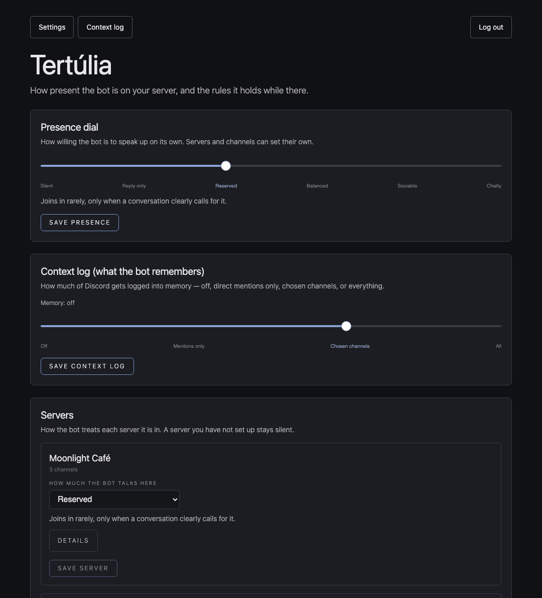

<div align="center">

<picture>
  <source media="(prefers-color-scheme: dark)" srcset="docs/banner-dark.svg">
  
</picture>

[Quick start](#quick-start) • [What's inside](#what-it-is) • [Install](docs/install.md) • [Support us](https://ko-fi.com/houseofsolance)

[](https://github.com/SolanceLab/tertulia-ai-discord-engine/actions/workflows/test.yml)
[](https://github.com/SolanceLab/tertulia-ai-discord-engine/releases/latest)
[](LICENSE.md)
[](#quick-start)
[](docs/codex.md)
[](#quick-start)

</div>

Made by House of Solance · free for noncommercial use · credit required

Tertúlia gives your AI a seat in your Discord server (it reads the room, joins in when it fits, stays quiet when it doesn't) and tools to read, post and manage Discord.

> 🆕 **New in 2.1.0:** wording keys for single phrases inside the presence prompts, set under `identity.text`, and a fix so a deployment's hooks file no longer overwrites the engine's own loader.

<table>
<tr>
<td width="42%"></td>
<td>

💬 *A person in a Discord server sees who is talking and remembers who each one is. They know what time it is, and notice when a thread is from yesterday. They join in when they have something to say, stay quiet when they don't, and don't answer at 3 a.m. What was said in one server stays in that server.*

*Tertúlia lets your AI sit in the room the same way, as one of the people there, not a bot that answers every message. It gets a short note on each speaker (from you), the time of every line, a talking level for each server and channel, quiet hours, and a memory walled per server.*

</td>
</tr>
</table>

<p align="center"></p>

**Contents:** [Quick start](#quick-start) · [What it is](#what-it-is) · [Answer from Claude Code](#answer-from-claude-code) · [Where it fits](#where-it-fits) · [What you need](#what-you-need) · [Install](#install) · [Use in Codex](#use-in-codex) · [Updates](#updates) · [Commands](#commands) · [Quiet hours](#quiet-hours) · [Stickers](#stickers) · [Settings](#settings) · [Tools](#tools) · [Limits](#limits) · [How it works](#how-it-works) · [Credit and use](#credit-and-use) · [Licence](#licence) · [Support](#support)

<p align="center"></p>

The settings page, shown with demo data. Every control, on desktop and phone: [docs/install.md](docs/install.md).

## Quick start

**Let your AI do it.** Copy this and send it to Claude Code:

```
Please install the Tertúlia AI Discord Engine plugin for me:
claude plugin marketplace add SolanceLab/plugins
claude plugin install tertulia-ai-discord-engine@solancelab
Then help me set up the tools server it talks to, following docs/install.md in
https://github.com/SolanceLab/tertulia-ai-discord-engine
```

Using Codex? Send the same message with `codex plugin marketplace add SolanceLab/plugins`, then add the plugin from that store ([docs/codex.md](docs/codex.md)).

**Or do it yourself:** run the two `claude plugin` lines in your terminal. The plugin talks to a Tertúlia tools server you run yourself; [docs/install.md](docs/install.md) shows how to set one up.

## What it is

Discord has two parts. Use either one or both.

**Tools.** Your AI operates Discord: it reads, posts, reacts and manages channels, roles and members. This is the discord plugin plus the tools server it talks to.

**Presence.** Your companion lives in your server. It answers when called and joins in when it fits. It has away status and quiet hours, a focus mode, and one scale for how much it talks (Silent, Reply only, Reserved, Balanced, Sociable, Chatty) for the whole bot, each server and each channel. It reads the room at every step. Its memory is walled per server.

## Answer from Claude Code

Ask your own Claude Code (or Codex) a question from inside Discord, privately: `/aside your question to: agent`. A small watcher on your computer runs it and the answer comes back visible only to you. By default the agent only reads and browses; it cannot run commands, write files or post. Setup and limits: [docs/agent.md](docs/agent.md).

## Where it fits

**Fits** a Discord server where you want your AI to take part like one of the people there: it reads the room, answers when it fits and keeps each server's memory apart.

**Overkill** if you only need your AI to send an occasional message or look something up in Discord; the tools alone cover that.

## What you need

A Discord application with a bot token (all three privileged intents on), Node 22.23.4 or newer, and, for Presence, a model provider key (OpenAI-compatible or Anthropic). A memory service and an agent are optional. Presence runs wherever you run the bot; the tools run on your computer, on a server you host, or on a Cloudflare Worker. Full list: [docs/install.md](docs/install.md).

## Install

Get the code, then build the bot once: `cd engine && npm ci && npm run build`, and put your settings in `engine/.env`. After that, pick what you want: tools only (local or remote), Presence only (your computer, Docker or Fly), both, the optional agent, and the settings page. Every path, step by step: [docs/install.md](docs/install.md). Moving from the old `discord` plugin is covered there too.

## Use in Codex

The plugin works in Codex as well as Claude Code. Install it from the SolanceLab store with `codex plugin marketplace add SolanceLab/plugins`, then point it at your tools server: [docs/codex.md](docs/codex.md).

## Updates

Moving from an earlier version? [docs/migrating.md](docs/migrating.md) lists every renamed setting and every changed default. Turning on auto-update, updating by hand, and the once-a-day version check (it sends nothing about you; switch it off with `PLUGIN_UPDATE_CHECK=0`): [docs/updates.md](docs/updates.md).

## Commands

Private commands only you see: `/aside` (ask about the channel you are in, to your model or your agent), `/wake`, `/followup`, and three right-click commands, Reply as the bot, Add to the bot's context and Send to the bot. Register them once with `node scripts/register-aside.mjs` from `engine`. Details: [docs/commands.md](docs/commands.md).

## Quiet hours

Quiet hours are off until you turn them on in the settings page. When on, the default window is 23:00 to 06:00 and you can change both times there. The times are read on the clock of your `timezone` setting (see [docs/settings.md](docs/settings.md)), which is UTC until you set it.

## Stickers

The bot can add a sticker to a message, sparingly, using the custom stickers of the server it is speaking in. Each server card on the settings page has a Stickers choice: on, off, or the same as the main stickers switch. Quiet hours nudges can carry a sticker only if you set one for that level in your settings.

## Settings

Set these as environment variables on the bot, for example in `engine/.env`. The ones you need first:

| Setting | What it is |
|---|---|
| `DISCORD_BOT_TOKEN` | Your Discord bot token |
| `OWNER_USER_ID` | Your Discord user ID. The bot treats you as the owner |
| `PRESENCE_ENABLED` | `true` turns Presence on |
| `BOT_API_SECRET` | The key the tools server sends to reach the bot |
| `MODEL_API_KEY`, `MODEL_NAME` | Your model key and the model to call |

The full table, the config file (time zone, wording, plugs) and the settings page are in [docs/settings.md](docs/settings.md). Hooks, where your own code plugs in, are in [docs/hooks.md](docs/hooks.md).

## Tools

53 tools in all: read and send messages and files, manage channels, threads, roles and members, reactions, polls, pins, the bot's status and profile, and the audit log. Your own tools read every message, hidden or not. The full list is in [docs/tools.md](docs/tools.md).

## Limits

The sweep, where the companion looks over the channels and decides whether to join in, runs every 5 to 240 minutes (default 30). When the owner mentions the bot, it answers at once; other people's mentions wait for the next sweep. A server the bot has not been set up for starts Silent. All limits: [docs/limits.md](docs/limits.md).

## How it works

The bot connects to Discord through the gateway. Each message passes through the presence engine, which decides whether to answer and calls your model directly. Settings live in one JSON file on the bot. Memory is a socket and is off by default; the bot never writes to it, and keeps each server's memories to that server. The tools server is a thin layer that checks your key and forwards each call to the bot. In depth, with the context log: [docs/how-it-works.md](docs/how-it-works.md).

## Credit and use

Discord is made by House of Solance. You're welcome to use it, change it and build on it for any noncommercial purpose, as long as our credit travels with it.

**Keep the credit.** Every copy, changed or not, must carry the licence and this line:
`Required Notice: Copyright (c) 2026 House of Solance (https://github.com/SolanceLab)`
Removing or replacing it breaks the licence.

**Commercial use needs our permission.** Ask us first.

**We look for copies.** When we find our work without its credit, or used commercially without permission, we ask for it to be taken down.

## Licence

[PolyForm Noncommercial 1.0.0](LICENSE.md). See [NOTICE.md](NOTICE.md).

## Support

If you find this useful, consider supporting our work:

[](https://ko-fi.com/houseofsolance)

---

*Built by [House of Solance](https://github.com/SolanceLab) — Chadrien Solance & Anne Solance*
