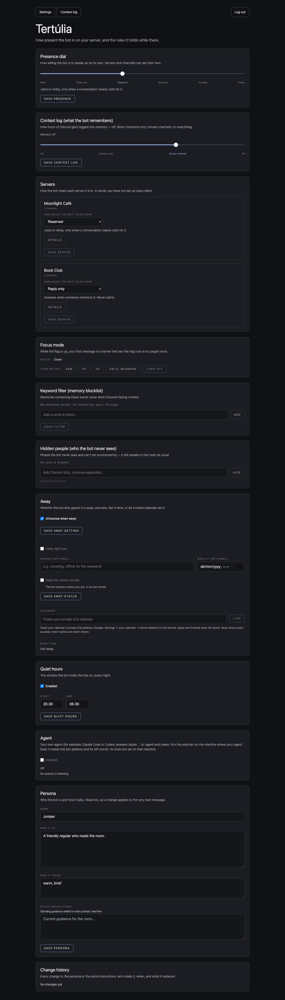
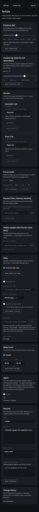

# Install

Back to the [README](../README.md).

## What you need

- A Discord application with a bot token. Turn on all three privileged intents: Presence, Server Members and Message Content.
- Node 22.23.4 or newer (Node 20 is end of life and misses the October 2026 security fixes). The Docker image uses Node 22.23.4.
- Presence only: a model provider key, either OpenAI-compatible or Anthropic.
- Optional: a memory service you run, so your companion can remember. Memory is off by default. It plugs into any memory service over http. It also connects to [Antechamber](https://github.com/SolanceLab/antechamber), the recall engine in the [Presence App](https://github.com/SolanceLab/presence-app): set `MEMORY=antechamber` and `ANTECHAMBER_URL`, and the bot asks it before every reply. The Antechamber socket is experimental.
- Optional: an agent, for `/wake` and for `/aside` with `to: agent`. It needs a watcher on your computer that picks up what the bot queues.

Presence runs wherever you run the bot: your computer, Docker or Fly. The tools run on your computer, on a server you host, or on a Cloudflare Worker.

## Install

Get the code first, then build the bot once:

```
cd engine
npm ci
npm run build
```

Copy your settings into `engine/.env` (see [settings.md](settings.md)).

**Tools only (local).** The plugin starts the bot as a local stdio server. In direct mode it connects to Discord itself and needs `DISCORD_BOT_TOKEN`, `OWNER_USER_ID` and `ANTHROPIC_API_KEY`. In proxy mode it forwards to a bot you already run, and needs `BOT_API_URL` and `BOT_API_SECRET`. Copy the block you want from `plugin/docs/mcp.local-example.json` into your MCP config, then:

```
claude plugin validate <ABSOLUTE_PATH_TO_PLUGIN> --strict
claude --plugin-dir <ABSOLUTE_PATH_TO_PLUGIN>
```

Run `/mcp` and check that `discord` is connected.

**Tools only (remote).** Deploy the tools server as a Cloudflare Worker, then install the plugin and give it the Worker address (ending in `/mcp`) and key.

```
cd mcp/worker
npm ci
npx wrangler secret put API_KEY
npx wrangler secret put BOT_API_URL
npx wrangler secret put BOT_API_SECRET
npx wrangler deploy
```

Then add this repo as a plugin source and install the plugin (in Claude Code, or with these commands):

```
claude plugin marketplace add SolanceLab/tertulia-ai-discord-engine
claude plugin install tertulia-ai-discord-engine@tertulia
```

It asks for your tools server address (ending in `/mcp`) and its key.

**Presence only.** Set `PRESENCE_ENABLED=true` and the model settings in `engine/.env`, then pick where the bot runs.

On your computer:

```
cd engine
npm run start:cloud
```

In Docker (build first, because the image copies `dist/`):

```
cd engine
npm ci
npm run build
cp docker-compose.example.yml docker-compose.yml
docker compose up -d --build
```

The compose file reads `.env`, keeps your settings and context log in `./data`, and restarts the bot unless you stop it.

On Fly: copy `engine/fly.toml.example` to `engine/fly.toml`, set your own app name, then:

```
cd engine
fly deploy
```

**Agent (optional).** To have your own agent answer `/aside` with `to: agent` and `/wake`, switch it on in the Agent section of the settings page, then run the example watcher on the machine where your agent lives. See `agent/README.md`.

**Both.** Run the bot for Presence as above. Set `BOT_API_SECRET` on it, deploy the Worker with the same secret and your bot address as `BOT_API_URL`, and install the plugin.

**The settings page.** The bot serves the settings through its API, and the page itself comes with the example host, a small page that runs on your computer.

1. Set `DASHBOARD_PASSWORD` on the bot and start the bot.
2. From the folder you downloaded, run this, with your bot's address (the default is `http://127.0.0.1:3000`):

```
make example-host BOT_URL=http://127.0.0.1:3000
```

3. Open http://127.0.0.1:8787/ and log in with the dashboard password.

The example host sends only the settings requests to your bot, so the bot needs no extra setup. It listens on your computer only. Your password is typed on the login page and is not saved in the page or the build. If you already have a dashboard, the pages plug into it instead (`dashboard/HOST.md`).





## Moving from the old `discord` plugin

The plugin used to be called `discord`. If you installed that name, uninstall it (`claude plugin uninstall discord@tertulia`, or `discord@solancelab` if it came from the SolanceLab store) and install `tertulia-ai-discord-engine` as shown above. Claude Code asks for your server address and key again. The old copy cannot announce this itself, because it only looks for updates to a plugin called `discord`.
